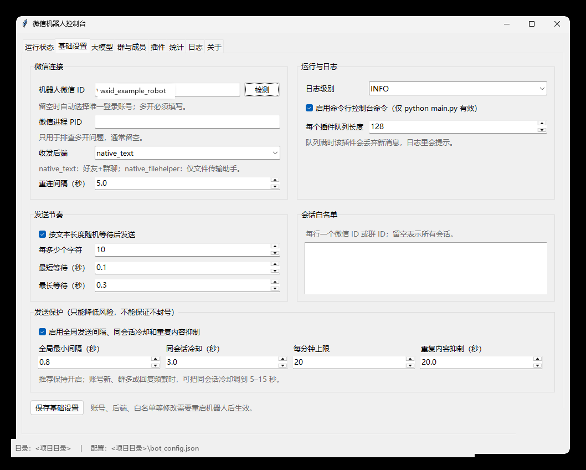
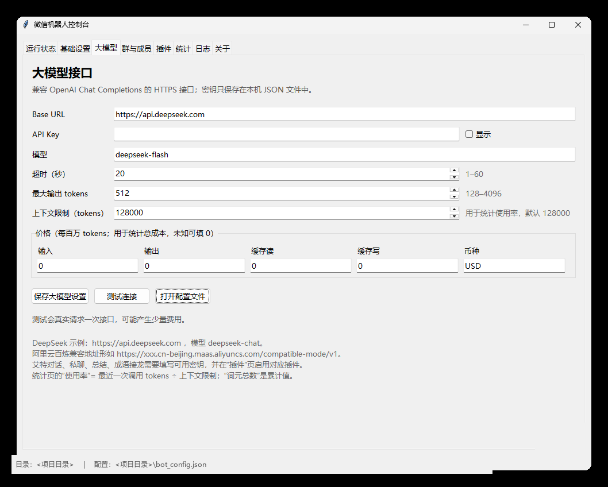
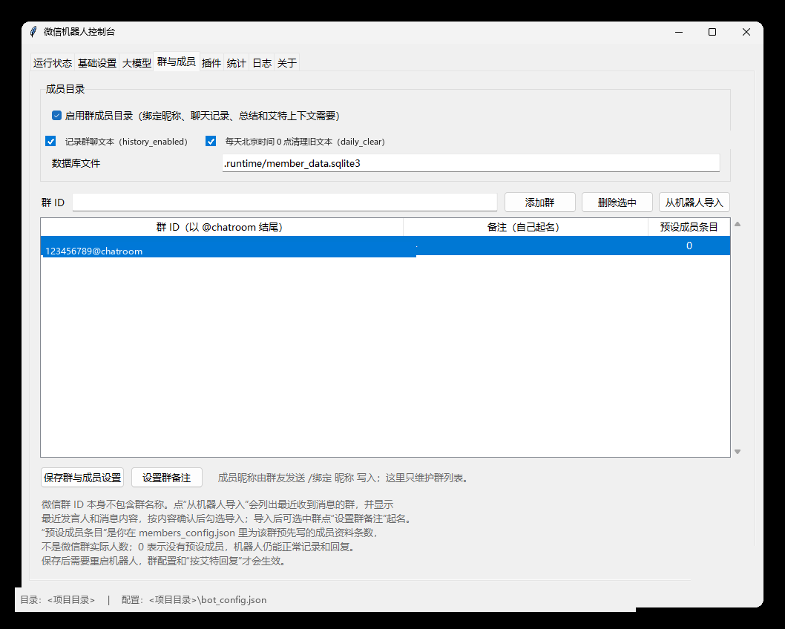
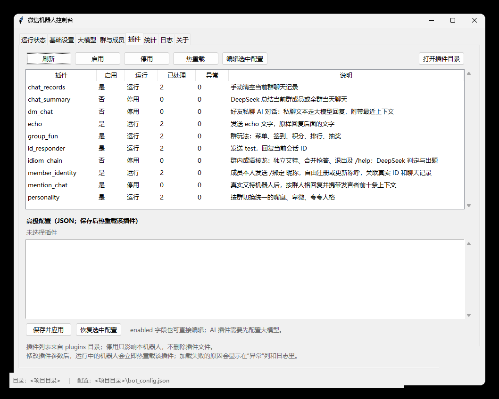
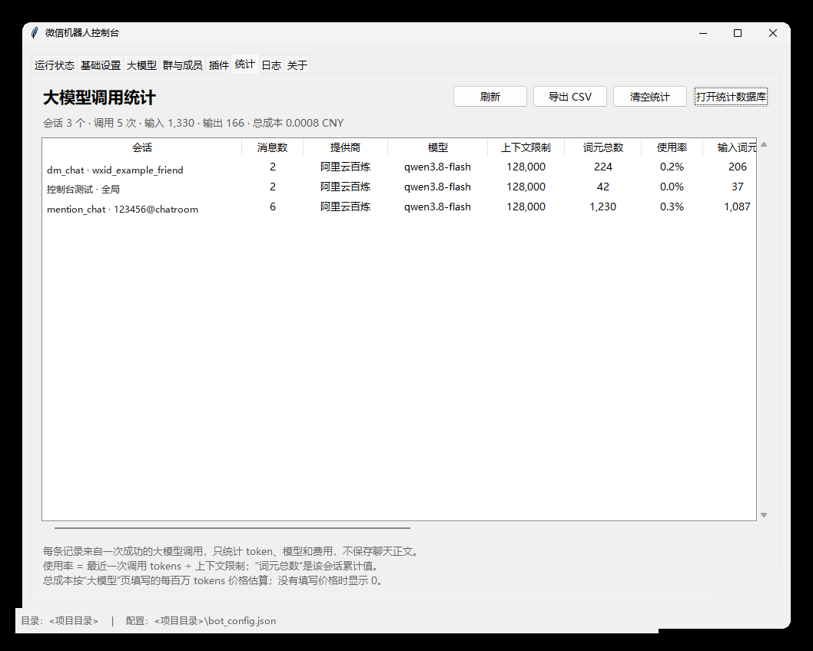
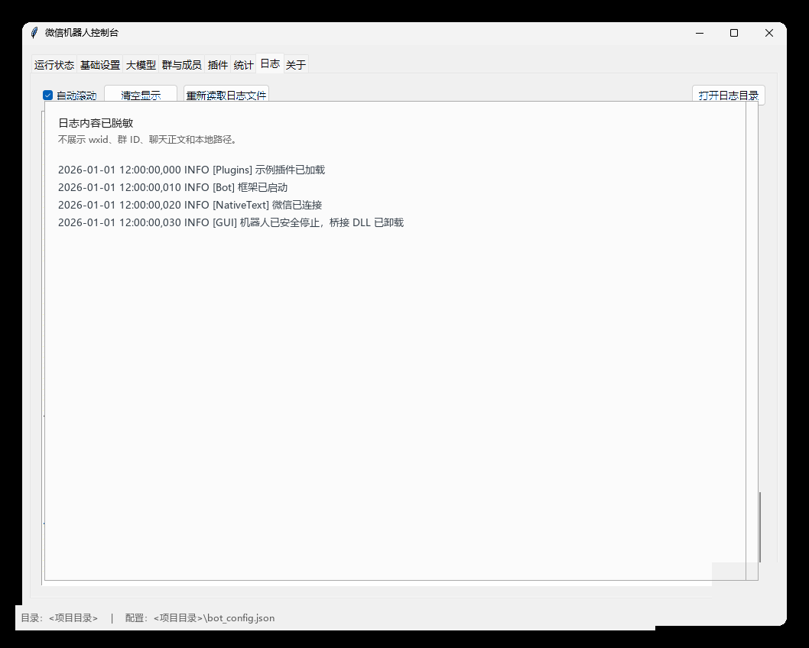
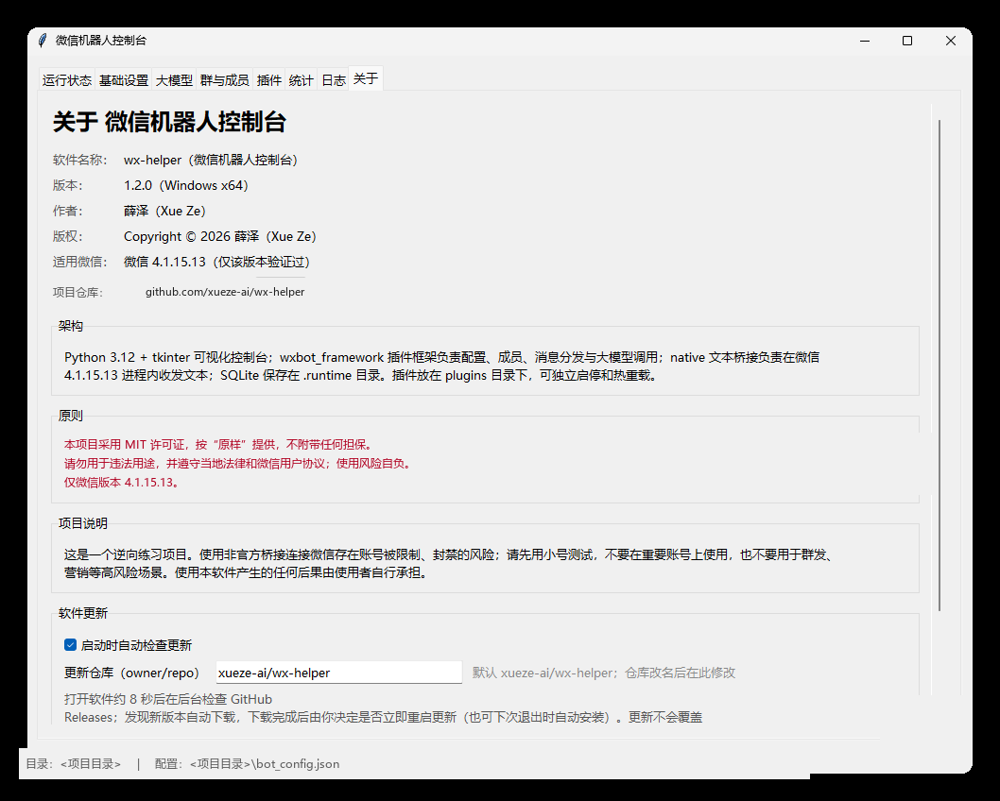

# wx-helper 微信机器人控制台

[](LICENSE)


面向 **Windows x64 + 微信 4.1.15.13** 的本地微信机器人框架，自带可视化控制台（tkinter），无需手动编辑 JSON 或敲 `python main.py` 就能完成账号连接、群配置、插件启停和大模型设置。项目采用 **MIT License** 开源，仓库地址：[github.com/xueze-ai/wx-helper](https://github.com/xueze-ai/wx-helper)。

> **仅供学习研究，请勿用于违法用途。**
> 使用非官方桥接连接微信存在账号被限制、封禁的风险；请先用小号测试，不要在重要账号或生产环境使用。本项目按“原样”提供，不附带任何担保；账号、数据或法律风险由使用者自行承担。仅验证过微信 **4.1.15.13**。

---

## 目录

- [功能一览](#功能一览)
- [快速开始](#快速开始)
- [图形界面使用教程](#图形界面使用教程)
  - [运行状态](#运行状态)
  - [基础设置](#基础设置)
  - [大模型](#大模型)
  - [群与成员](#群与成员)
  - [插件](#插件)
  - [统计](#统计)
  - [日志](#日志)
  - [关于与自动更新](#关于与自动更新)
- [群聊里被 @ 时自动回复](#群聊里被--时自动回复)
- [插件清单与命令](#插件清单与命令)
- [实现原理](#实现原理)
- [项目结构](#项目结构)
- [如何降低微信风控风险](#如何降低微信风控风险)
- [安全与隐私](#安全与隐私)
- [配置文件参考](#配置文件参考)
- [打包成 EXE](#打包成-exe)
- [命令行用法](#命令行用法)
- [本地测试](#本地测试)
- [能否放在服务器上运行](#能否放在服务器上运行)
- [参与贡献](#参与贡献)
- [常见问题 FAQ](#常见问题-faq)
- [免责声明](#免责声明)
- [许可证](#许可证)

---

## 功能一览

- 文件传输助手、好友和群聊文本收发，以及**真正的群内 @**（不是普通文字“@昵称”）。

- **群聊里被 @ 时自动回复**：携带该成员当天此前最多 10 条有效发言作为上下文。

- 好友私聊 AI 回复（`dm_chat`，默认关闭，可配置白名单）。

- 群玩法：`/菜单`、`/签到`、`/积分`、`/排行`、`/抽奖`（`group_fun`）。

- 聊天记录与总结：`/总结 昵称`、`/总结群聊`、`/清空`。

- 成语接龙：`plugins/idiom_chain`，独立玩家、合并抢答和退出模式。

- 人格切换：`/切换人格 嘴臭|卑微|夸夸|取消`，按群保存。

- 成员绑定：`/绑定 昵称`，按群保存称呼。

- **大模型调用统计**：按会话统计消息数、输入/输出/推理/缓存 tokens、使用率、费用、时间等。

- **发送保护**：全局发送间隔、同会话冷却、每分钟上限、重复内容抑制，降低被风控注意的概率。

- **自动更新**：启动约 8 秒后检查 GitHub Releases，下载后由用户决定立即重启更新或退出时安装。

- 可视化控制台：账号检测、微信 PID、群导入、插件热重载、实时日志、一键停止/清理桥接 DLL。

- 单目录 EXE 打包：`plugins/`、`native/` 保持外部可编辑。

---

## 快速开始

### 环境要求

- Windows 10/11 或 Windows Server 2019/2022（Desktop Experience）。
- 微信 **4.1.15.13**（其他版本未验证，核心 DLL 指纹可能不匹配）。
- 建议 64 位 Python 3.12（源码运行）；使用打包 EXE 时不需要 Python。
- 可用的 OpenAI 兼容大模型接口（如需 AI 回复、总结、接龙点评）。

### 源码运行

```powershell
git clone https://github.com/xueze-ai/wx-helper.git
cd wx-helper
py -3.12 -m venv .venv
.\.venv\Scripts\Activate.ps1
python -m pip install -r requirements.txt
python gui.py
```

首次启动会从 `*.example.json` 生成空的本地配置。请不要把生成的 `bot_config.json`、`llm_config.json`、`members_config.json` 提交到 Git。

也可以先运行 `python tools\init_config.py` 生成配置，再手动编辑；已存在的文件不会被覆盖。

> 只有需要重新编译原生桥接或打包 EXE 时才需要 `requirements-build.txt` 和 Visual Studio Build Tools。普通源码运行不需要。

### 使用打包版

把整个 `dist\wx-helper` 目录复制到目标电脑，双击 `wx-helper.exe`。首次运行会自动从 `*.example.json` 生成：

- `bot_config.json`：机器人账号、后端、群白名单、发送节奏、发送保护、插件开关。
- `llm_config.json`：大模型地址、密钥、模型、上下文限制和价格。
- `members_config.json`：聊天记录开关、群列表、群备注。

`plugins/` 和 `native/` 必须和 EXE 放在同一层目录，不要只复制单个 EXE。

---

## 图形界面使用教程

### 运行状态

- **启动机器人**：连接当前登录的微信进程，开始接收消息并分发插件。
- **停止机器人（Quit）**：安全停止顺序为停插件 → 停接收线程 → 在微信进程内卸载桥接 DLL。看到“框架已停止 / 桥接 DLL 已卸载”后再关闭窗口。
- **清理残留桥接**：扫描并卸载微信进程里残留的 `text_bridge.dll`。如果停止时清理失败，控制台会保留实例锁，先点此按钮再重试启动。
- 面板显示连接状态、微信 PID、当前账号、插件加载数量、最近错误。

> 不要用任务管理器强杀 `wx-helper.exe`；强杀会留下已注入的 DLL，下次启动可能提示“桥接 DLL 已加载”。

### 基础设置

- **机器人微信 ID**：可点“检测当前登录账号”；启用成员目录时必须明确填写。
- **微信 PID**：留空时自动查找已登录的微信；多开微信时填写目标进程 PID。
- **收发后端**：文本机器人使用 `native_text`；旧的文件传输助手方案用 `native_filehelper`。
- **重连间隔**：微信重启或连接断开后的重试间隔。
- **发送节奏**：按文本长度随机等待后发送（默认每 10 字 0.1–0.3 秒），让发送不至于过于机械。
- **发送保护**：
  - 全局最小间隔：任意两条消息之间的最小间隔（默认 0.8 秒，带随机抖动）。
  - 同会话冷却：同一个群/好友连续回复的最小间隔（默认 3 秒）。
  - 每分钟上限：每分钟最多发送多少条（默认 20）。
  - 重复内容抑制：同一会话在窗口期内出现完全相同的内容时跳过发送（默认 20 秒）。
  - **推荐保持开启**；账号较新、群较多或回复频繁时，可把同会话冷却调到 5–15 秒。
- **会话白名单**：每行一个微信 ID 或群 ID；留空表示所有会话。
- **日志级别 / 命令行控制台**：一般保持 `INFO`；`DEBUG` 仅排查问题时使用。

点击“保存基础设置”后，部分修改需要重启机器人（面板会提示）。

<p align="center">
  <a href="docs/screenshots/01-basic-settings.png"></a>
</p>
<p align="center">
  <sub>图 1 · 基础设置：微信连接、收发后端、发送节奏与发送保护（已脱敏）</sub>
</p>

### 大模型

- **Base URL**：OpenAI 兼容接口地址，例如 `https://api.deepseek.com`。
- **API Key**：只保存在本机 `llm_config.json`，界面上可点“显示/隐藏”。
- **模型**：例如 `deepseek-chat`。
- **超时 / 最大输出 tokens**：默认 20 秒、512 tokens。
- **上下文限制（tokens）**：用于统计页计算“使用率”，默认 128000；按你所用模型的真实上下文填写。
- **价格（每百万 tokens）**：输入、输出、缓存读、缓存写和币种。用于估算统计页的“总成本”；不清楚时填 0，成本显示为 0。
- **测试连接**：真实请求一次接口，可能产生少量费用；测试调用也会记入统计。
- 修改后点击“保存大模型设置”；正在运行的插件重启后使用新配置。

<p align="center">
  <a href="docs/screenshots/02-llm-settings.png"></a>
</p>
<p align="center">
  <sub>图 2 · 大模型：OpenAI 兼容接口、模型、上下文限制与价格配置（已脱敏）</sub>
</p>

### 群与成员

- 顶部开关：
  - **启用群成员目录**：绑定昵称、聊天记录、总结和艾特上下文都依赖它。
  - **记录群聊文本（history_enabled）**：`mention_chat` 必须开启。
  - **每天北京时间 0 点清理旧文本（daily_clear）**：`chat_summary` 必须开启。
- **添加群**：填写群 ID（以 `@chatroom` 结尾），或点“从机器人导入”。
- **从机器人导入**：如果不知道群 ID，先在每个微信群发一条内容不同的消息，再打开导入对话框。列表显示群 ID、备注、最近发言人、最近消息和时间，按内容确认后多选导入；导入会自动保存。
- **设置群备注**：给群 ID 起一个自己看得懂的名字，显示在群列表和统计页；备注保存在 `members_config.json` 的 `group_labels`。
- **预设成员条目**：这一列是你在 `members_config.json` 里为该群**预先填写**的成员资料条数，**不是微信群实际人数**。`0` 表示没有预设成员，机器人仍然可以正常记录聊天、回复和总结；成员昵称一般由群友发送 `/绑定 昵称` 自动写入。
- 群列表、备注和开关修改后需要重启机器人才能生效。

<p align="center">
  <a href="docs/screenshots/03-groups-members.png"></a>
</p>
<p align="center">
  <sub>图 3 · 群与成员：成员目录开关、群列表、群备注与「从机器人导入」（已脱敏）</sub>
</p>

### 插件

- **启用 / 停用**：修改插件开关并保存到 `bot_config.json`；正在运行的插件立即收到启停指令。
- **热重载**：重新加载选中插件，适合改完插件配置或代码后快速验证。
- **编辑选中配置**：直接编辑该插件的 JSON 高级参数（例如 `dm_chat` 的 `allow_from`、`history_size`）。
- **打开插件目录**：自行添加新插件；`_template` 是开发模板。

<p align="center">
  <a href="docs/screenshots/04-plugins.png"></a>
</p>
<p align="center">
  <sub>图 4 · 插件：启停、热重载、处理 / 异常计数与高级 JSON 配置（已脱敏）</sub>
</p>

### 统计

统计页按“插件 + 会话”聚合大模型调用，每一条记录对应一次成功的接口调用（不保存聊天正文和密钥）：

| 列 | 含义 |
| --- | --- |
| 会话 | 插件名 + 群备注或会话 ID；没有具体会话时显示“全局” |
| 消息数 | 该会话的调用次数 × 2（每次调用算 1 条用户消息 + 1 条助手消息） |
| 提供商 | 根据 `base_url` 识别的服务商，如 DeepSeek、阿里云百炼 |
| 模型 | `llm_config.json` 中的模型名 |
| 上下文限制 | “大模型”页填写的 `context_limit` |
| 词元总数 | 该会话累计 tokens |
| 使用率 | **最近一次调用** tokens ÷ 上下文限制；超过 60% 橙色、85% 红色 |
| 输入 / 输出 / 推理词元 | 对应 usage 字段的累计值 |
| 缓存词元（读/写） | 缓存命中/写入 tokens（接口有返回时统计） |
| 用户消息 / 助手消息 | 调用次数（分别代表请求和回复） |
| 总成本 | 按填写的价格估算；接口直接返回 cost 时优先使用接口值 |
| 创建时间 / 最后活动 | 该会话第一条和最后一条记录的时间 |

工具栏支持 **刷新、导出 CSV、清空统计、打开统计数据库**。数据库位于 `.runtime/llm_usage.sqlite3`，只包含 token 数量、模型、时间和费用。

<p align="center">
  <a href="docs/screenshots/05-usage-stats.png"></a>
</p>
<p align="center">
  <sub>图 5 · 统计：按「插件 + 会话」聚合的消息数、tokens、使用率与总成本（已脱敏）</sub>
</p>

### 日志

- 实时显示 `logs/bot.log` 的内容，最新日志自动滚动。
- “加载日志文件”读取最近 500 行；“清空视图”只清界面显示，不删除日志文件。
- 日志文件按 2 MB 轮转，保留 3 份备份。

<p align="center">
  <a href="docs/screenshots/06-logs.png"></a>
</p>
<p align="center">
  <sub>图 6 · 日志：实时滚动显示 <code>logs/bot.log</code>，插件加载失败也会标红提示（内容已脱敏示意）</sub>
</p>

### 关于与自动更新

“关于”页显示：

- 软件名称：wx-helper（微信机器人控制台）
- 版本：当前版本号
- 作者：薛泽（Xue Ze）
- 版权：Copyright © 2026 薛泽（Xue Ze）
- 许可证：MIT
- 项目仓库：`github.com/xueze-ai/wx-helper`
- 适用微信：4.1.15.13
- 架构、原则和项目说明

**软件更新**：

1. 打开软件约 8 秒后，后台检查 GitHub Releases（可取消“启动时自动检查更新”）。默认更新仓库是 `xueze-ai/wx-helper`，仓库改名后可在“关于”页直接修改。
2. 发现新版本后自动下载；下载完成后弹窗让你选择：
   - **是**：立即安全停止机器人，关闭控制台，替换程序文件并自动重启（带 `--autostart`）。
   - **否**：本次退出时自动安装。
   - **取消**：跳过这个版本，之后可手动“检查更新”。
3. 更新**不会覆盖** `bot_config.json`、`llm_config.json`、`members_config.json`、`.runtime` 和 `logs`。
4. 源码运行模式不会自动安装，只会提示有新版本，请自行 `git pull` 或重新下载 Release。
5. 更新日志写在 `.runtime/updates/update.log`；如果替换失败，安装脚本会尝试重新启动旧版本。

<p align="center">
  <a href="docs/screenshots/07-about.png"></a>
</p>
<p align="center">
  <sub>图 7 · 关于：版本、作者、架构原则与自动更新仓库设置（已脱敏）</sub>
</p>

---

## 群聊里被 @ 时自动回复

### 1. 配置群

1. 确认“基础设置”里填写了机器人微信 ID，或点了“检测当前登录账号”。
2. 确认“群与成员”里“启用群成员目录”和“记录群聊文本”已打开，然后保存。
3. 添加目标群 ID，或点“从机器人导入”按最近消息辨认群。
4. 重启机器人（群配置在重启后生效）。

### 2. 启用插件

1. 打开“插件”页，启用 `mention_chat`。
2. 确保“大模型”页填好可用的 `base_url`、`api_key` 和 `model`。
3. 保存并重启机器人。

### 3. 使用

在群里真正 **@机器人** 并发送文字，机器人会用本群人格回复当前发言者；历史只包含该发言者此前最多 10 条有效发言。

### 4. 不回复时检查

- 群里是否真的 @ 了机器人（必须是微信的 @ 通知，不是手打“@昵称”）。
- `mention_chat` 是否启用，`history_enabled` 是否为 `true`。
- 群 ID 是否在 `members_config.json` 的 `groups` 中。
- `llm_config.json` 的密钥、余额和模型是否可用。
- 以 `/` 开头的命令会交给命令插件处理，不会被当成普通聊天回复。

### 5. 不会重复回复

框架会给每条入站消息记录“回复归属”：第一个发送回复的插件拥有该消息，其他插件不会再发第二条。`group_fun` 命令（如 `/菜单`）和 `mention_chat` 同时启用时，只会收到一份菜单回复；`mention_chat` 也会主动跳过以 `/` 开头的命令。分段长回复仍由同一个插件连续发送，不会被误拦。

---

## 插件清单与命令

| 插件 | 默认 | 说明 |
| --- | --- | --- |
| `mention_chat` | 关闭 | 群里真正 @ 机器人后，用本群人格回复当前发言者 |
| `dm_chat` | 关闭 | 好友私聊 AI 回复，可配置 `allow_from` 白名单和 `history_size` |
| `chat_summary` | 关闭 | `/总结 昵称`、`/总结群聊` |
| `chat_records` | 开启 | 记录群聊文本，供总结、艾特上下文使用 |
| `group_fun` | 开启 | `/菜单`、`/签到`、`/积分`、`/排行`、`/抽奖` |
| `idiom_chain` | 关闭 | 成语接龙，可配置 `member_names` |
| `member_identity` | 开启 | `/绑定 昵称`；按群保存 |
| `personality` | 开启 | `/切换人格 嘴臭\\|卑微\\|夸夸\\|取消` |
| `echo` | 关闭 | 测试插件：`echo 内容` 原样回复 |
| `id_responder` | 开启 | 群内被 @ 时返回身份信息 |
| `_template` | — | 新插件开发模板 |

其他群命令：

```text
/绑定 昵称                 设置当前群里的称呼
/总结 昵称                 总结该成员当天的群聊文字
/总结群聊                  总结当前群当天的群聊文字
/切换人格 嘴臭|卑微|夸夸|取消  设置当前群的回复人格
/清空                      清理当前群当天的机器人文本记录
/菜单                      显示群玩法菜单
/签到 /积分 /排行 /抽奖      群玩法
```

---

## 实现原理

### 原生文本桥接

本项目不使用网页协议或官方 API。Windows 端把 `native/build_text/text_bridge.dll` 注入本机的 `weixin.exe`，通过 `ReadProcessMemory` / `CreateRemoteThread` / MinHook 调用微信 **4.1.15.13** 内部函数完成：

- 读取消息回调（文本、群、@ 通知、发送者）。
- 发送文本和群 @ 消息。
- 查询已登录账号、群与最近会话。

`native/compatibility.json` 保存版本指纹；微信升级后指纹不匹配会拒绝注入。

### 消息流与插件系统

1. 原生桥接把消息交给 `wxbot_framework`，由成员目录按“账号 + 群 + 成员”隔离存储。
2. `PluginManager` 为每个插件维护独立队列和线程，按加载顺序分发消息。
3. 插件通过 `PluginContext` 调用 `reply` / `reply_at` / `send_text`；框架负责目标校验、会话版本校验、发送节奏、发送保护、重复回复归属和错误隔离。
4. 插件异常只影响自身，不会中断接收线程；可在“插件”页查看每个插件的处理数、丢弃数和最近错误。
5. `/切换人格`、`/清空` 等命令在接收线程中先处理，再分发，避免同一批消息使用旧人格。

### 大模型与统计

- `wxbot_framework/llm.py` 调用 OpenAI 兼容的 `POST /chat/completions`，要求返回 JSON 对象。
- 每次成功调用后解析 `usage`：`prompt_tokens` / `completion_tokens` / `total_tokens`、缓存命中、推理 tokens，并按 `llm_config.json` 的 `pricing` 估算费用。
- `wxbot_framework/usage.py` 把统计写入 `.runtime/llm_usage.sqlite3`，控制台“统计”页按会话聚合读取。
- 统计失败只记日志，不影响机器人回复。

### 配置与数据文件

```text
bot_config.json         运行配置、插件开关、发送节奏、发送保护
llm_config.json         大模型地址、密钥、模型、上下文限制、价格
members_config.json     成员目录、群列表、群备注、记录开关
.runtime/               成员数据库、群玩法积分库、大模型用量库、更新缓存
.runtime/llm_usage.sqlite3   统计数据库
.runtime/member_data.sqlite3 聊天记录与成员数据
logs/bot.log            运行日志
plugins/                外部插件目录
native/                 桥接 DLL 与版本指纹
```

---

## 项目结构

```text
wx-helper/
├─ gui.py                   图形控制台入口
├─ main.py                  命令行入口
├─ wxbot_framework/         配置、消息分发、成员、LLM、统计、发送保护、更新
├─ plugins/                 可独立启停的外部插件
│  ├─ _template/            新插件模板
│  ├─ mention_chat/         群内真实 @ 回复
│  ├─ dm_chat/              好友私聊 AI 回复
│  ├─ group_fun/            签到、积分、抽奖、菜单
│  ├─ chat_summary/         成员/群聊总结
│  ├─ chat_records/         群聊文本记录
│  ├─ member_identity/      /绑定 昵称
│  ├─ personality/          按群人格
│  ├─ idiom_chain/          成语接龙
│  ├─ echo/                 测试插件
│  └─ id_responder/         旧版身份信息插件
├─ native/                  原生桥接源码、Python 服务、MinHook、兼容性指纹
├─ tests/                   不连接微信的单元测试
├─ tools/                   初始化配置、打包、发布前隐私检查
├─ docs/screenshots/        已脱敏的界面截图
├─ .github/                 Issue 与 PR 模板
├─ bot_config.example.json  公开配置模板
├─ llm_config.example.json  公开大模型模板（API Key 为空）
├─ members_config.example.json
├─ requirements.txt         运行依赖
├─ requirements-build.txt   打包依赖
├─ start_bot.ps1            Windows 启动脚本
├─ LICENSE                  MIT 许可证
├─ SECURITY.md              安全报告与使用边界
├─ PRIVACY.md               数据流与隐私说明
├─ CONTRIBUTING.md          开发、测试和提交规范
├─ CODE_OF_CONDUCT.md       社区行为准则
├─ CHANGELOG.md             版本记录
└─ THIRD_PARTY_NOTICES.md   第三方组件许可证
```

`bot_config.json`、`llm_config.json`、`members_config.json`、`.runtime/` 和 `logs/` 是使用者本地生成的文件，已在 `.gitignore` 中排除，不应出现在公开仓库。

---

## 如何降低微信风控风险

**先说明：任何第三方桥接都无法保证账号安全，以下措施只能降低被风控注意到的概率。** 请务必先使用小号测试，并控制使用频率。

已经内置的保护：

- **只回复艾特/私聊**：`mention_chat` 只在真正 @ 机器人时回复，不会主动扫群、群发或给所有人发消息。
- **发送节奏**：按文本长度随机等待，避免固定毫秒级机械发送。
- **发送保护**：全局最小间隔（带随机抖动）、同会话冷却、每分钟上限、重复内容抑制。
- **重复回复归属**：同一条消息只由一个插件回复，避免一次 @ 触发多条消息刷屏。
- **不回复自己**：机器人自己发的消息不会再次触发插件。
- **会话白名单**：可把机器人限制在少数几个群/好友内。
- **长回复分段**：由框架按文本长度拆分后逐段发送，而不是一次性轰炸。

使用建议：

1. 新账号先养号，不要一上来就高频自动回复。
2. 把“同会话冷却”调大（5–15 秒），“每分钟上限”调小（3–10 条）。
3. 不要在多个大群同时运行；不要用于营销、拉群、加好友、私信广告。
4. 回复内容保持自然、有信息量；避免相同文案反复发送（重复内容抑制也会帮助拦截）。
5. 发现账号出现“操作频繁”“当前账号存在安全风险”等提示时，立即停止机器人几天。
6. 定期备份 `bot_config.json`、`llm_config.json`、`members_config.json` 和 `.runtime`。
7. 微信版本、登录环境变化都可能影响风控策略，建议用独立小号承担风险。

---

## 安全与隐私

本项目默认**只在本机运行**，没有自建遥测、埋点或远程日志服务器。详细的数据流见 [PRIVACY.md](PRIVACY.md)，漏洞报告方式见 [SECURITY.md](SECURITY.md)。

### 本机数据

| 文件 | 内容 |
| --- | --- |
| `bot_config.json` | 机器人 wxid、PID、群白名单、插件开关、发送保护 |
| `llm_config.json` | 大模型地址、API Key、模型和价格 |
| `members_config.json` | 群 ID、群备注、预设成员 |
| `.runtime/member_data.sqlite3` | 成员目录和聊天正文 |
| `.runtime/fun_data.sqlite3` | 群玩法积分与签到 |
| `.runtime/llm_usage.sqlite3` | token 统计、模型、费用；不保存聊天正文 |
| `logs/bot.log` | 插件日志；可能含 wxid、群 ID、路径和错误堆栈 |

这些文件默认是明文，不会上传到作者服务器。请用 Windows 账户权限、BitLocker 或文件夹访问控制保护；不要把 `.runtime`、`logs` 或真实配置提交到 Git。

### 大模型请求

只有启用 AI 插件并触发时，才会把必要的上下文发送到 `llm_config.json` 中填写的 OpenAI 兼容接口。不同服务商的数据保留和训练策略不同，请阅读其隐私政策，并使用独立、低额度的 API Key。

### 自动更新

启动约 8 秒后（可关闭）访问 GitHub API 检查 Release；下载完成后由你选择安装时机。更新检查不会上传聊天记录、API Key 或本机数据库。

### 发布前检查

```powershell
python tools\check_publication.py
```

检查脚本只输出文件路径和问题类型，不打印密钥原文。提交截图前，请人工确认 wxid、群 ID、群名、头像、昵称、聊天正文和本地路径都已遮挡。

### 如果密钥泄露

1. 立刻在服务商控制台吊销并轮换 API Key；
2. 删除对应的本地配置或日志；
3. 如果已经推送 Git，仅删除文件不够，需用 `git filter-repo` 等工具清理历史；
4. 检查账单和调用记录，确认没有被滥用。

---

## 配置文件参考

### bot_config.json

```json
{
  "backend": "native_text",
  "chat_allowlist": [],
  "wechat_pid": null,
  "wechat_account": "wxid_你的机器人",
  "reconnect_seconds": 5,
  "plugin_queue_size": 128,
  "console": true,
  "log_level": "INFO",
  "llm_config_file": "llm_config.json",
  "members_config_file": "members_config.json",
  "text_send_delay": {
    "enabled": true,
    "characters_per_group": 10,
    "min_seconds": 0.1,
    "max_seconds": 0.3
  },
  "send_guard": {
    "enabled": true,
    "min_interval_seconds": 0.8,
    "per_chat_seconds": 3.0,
    "max_per_minute": 20,
    "duplicate_window_seconds": 20.0,
    "jitter_ratio": 0.25
  },
  "plugins": {
    "mention_chat": {"enabled": true},
    "chat_summary": {"enabled": false},
    "dm_chat": {"enabled": false, "allow_from": [], "history_size": 10},
    "group_fun": {"enabled": true},
    "personality": {"enabled": true}
  }
}
```

### llm_config.json

```json
{
  "base_url": "https://api.deepseek.com",
  "api_key": "",
  "model": "deepseek-flash",
  "timeout_seconds": 20,
  "max_tokens": 512,
  "context_limit": 128000,
  "pricing": {
    "input_per_million": 0,
    "output_per_million": 0,
    "cache_read_per_million": 0,
    "cache_write_per_million": 0,
    "currency": "USD"
  }
}
```

`api_key` 首次生成时为空，请在控制台“大模型”页填写，不要把真实 Key 写进 README、Issue 或提交记录。价格用于统计页“总成本”估算；接口返回 `usage.cost` 时优先使用接口值。缓存的计价方式以服务商账单为准。

### members_config.json

```json
{
  "database_file": ".runtime/member_data.sqlite3",
  "history_enabled": true,
  "daily_clear": true,
  "groups": {
    "123456789@chatroom": []
  },
  "group_labels": {
    "123456789@chatroom": "示例群聊"
  }
}
```

`groups` 的值是该群的预设成员资料数组，可以为空 `[]`；成员昵称会由 `/绑定 昵称` 自动写入，`group_labels` 只影响界面显示。

---

## 打包成 EXE

```powershell
powershell -ExecutionPolicy Bypass -File tools\build_exe.ps1
powershell -ExecutionPolicy Bypass -File tools\build_exe.ps1 -NoInstall
powershell -ExecutionPolicy Bypass -File tools\build_exe.ps1 -OneFile
```

- 默认 `--onedir`，产物在 `dist\wx-helper\`，**必须整个目录分发**。
- `-OneFile` 生成单文件版，但 `plugins/` 和 `native/` 仍需放在 EXE 同级目录。
- 构建会重建 `dist\wx-helper`；如果该目录里已有真实配置、`.runtime` 或 `logs`，先备份，构建后复制回去。
- 脚本会自动复制 `plugins/`、`native/`、`README.md`、`THIRD_PARTY_NOTICES.md` 和示例配置。

---

## 命令行用法

```powershell
python main.py                 # 命令行运行机器人
python main.py --check         # 只检查配置、插件清单和语法，不连接微信
python main.py --cleanup       # 只扫描并卸载残留桥接 DLL
```

控制台命令：

```text
status
chats
members [群ID]
history 称呼 [条数]
plugins
enable 插件名
disable 插件名
reload [插件名]
quit
```

正常停止请在控制台输入 `quit`，或点击控制台“停止机器人（Quit）”。修改账号、群和成员配置后重启生效；微信可以保持打开。

`start_bot.ps1` 是源码启动脚本，优先使用项目 `.venv`，其次使用 PATH 中的 Python；可用 `-Python` 或环境变量 `WXBOT_PYTHON` 指定解释器。

---

## 本地测试

```powershell
python -B -m unittest discover -s tests -v
```

测试不连接微信、不调用真实大模型，覆盖消息模型、成员目录、人格、艾特、总结、接龙、发送节奏、发送保护、回复归属和用量统计等。测试临时文件写入系统临时目录，不读取本机账号配置。

---

## 能否放在服务器上运行

**结论：Linux 服务器不行；Windows 服务器或 Windows 云电脑可以，但必须是带桌面会话的完整 Windows。**

本项目把 `text_bridge.dll` 注入本机的 `weixin.exe`，再用 `ReadProcessMemory` / `CreateRemoteThread` / MinHook 调用微信内部函数，因此：

- Linux、Docker、WSL、Windows Server Core 都不行：没有可注入的 Windows 微信进程。
- 微信必须处于登录状态并持续运行；机器人必须运行在同一个 Windows 用户会话中。
- 不能用“Windows 服务”方式运行：服务位于 Session 0，没有桌面，无法登录微信。
- 微信升级会改变核心 DLL 指纹；`native/compatibility.json` 校验失败后需要重新适配，不能随意升级。
- 重启服务器或微信退出后，通常需要手机扫码/确认重新登录，无法完全无人值守。

可行方案：

1. **Windows VPS / 云电脑**（Windows Server 2019/2022 Desktop Experience，或 Windows 10/11）。安装微信 4.1.15.13，用 RDP 登录并扫码；复制整个 `dist\wx-helper`，用界面的开机启动快捷方式或任务计划程序（**只在用户登录时运行**）启动。断开 RDP 时选择“断开连接”，不要“注销”。
2. **家里或公司的 Windows 小主机**：最稳定，和微信同机运行；配置开机自动登录后自动启动。
3. **Linux 服务器 + Windows 虚拟机**：在 KVM/VMware 中安装 Windows 10/11，再按方案 1 运行。

建议配置：2 核 CPU、4 GB 内存起步（8 GB 更稳）、40 GB 磁盘。请务必控制频率并使用小号，注意微信使用条款和封号风险。

---

## 参与贡献

欢迎提交 Issue、插件、文档和测试。开始之前请阅读：

- [CONTRIBUTING.md](CONTRIBUTING.md)：开发环境、测试、插件编写和提交规范；
- [PRIVACY.md](PRIVACY.md)：哪些数据会留在本机、哪些会发给大模型；
- [SECURITY.md](SECURITY.md)：漏洞报告渠道和安全边界；
- [CODE_OF_CONDUCT.md](CODE_OF_CONDUCT.md)：社区行为准则。

最小贡献流程：

```powershell
python -m unittest discover -s tests -v
python tools\check_publication.py
```

提交前请确认没有真实 API Key、wxid、群 ID、聊天记录、日志、数据库或未脱敏截图。发现安全问题请不要公开利用细节，使用 GitHub 的私密漏洞报告。

---

## 常见问题 FAQ

**Q：怎么把群 ID 和微信群对应起来？**
微信群 ID 本身不带群名称。给每个群发一条内容不同的消息，然后打开“群与成员”→“从机器人导入”，按“最近消息”确认群，再导入并“设置群备注”。

**Q：“预设成员条目”是什么？是群人数吗？**
不是。它是 `members_config.json` 里该群预先配置的成员资料条数；`0` 表示没有预设成员，不影响记录聊天、@ 回复和总结。群友发的 `/绑定 昵称` 会自动补充成员信息。

**Q：为什么一条消息收到了两条回复？**
旧版本是多个插件同时抢答。现在框架会为每条入站消息记录回复归属，第一个回复的插件独占，其他插件跳过；`mention_chat` 也会跳过 `/` 开头的命令。请更新到包含该修复的版本。

**Q：点了停止但提示“桥接 DLL 已加载”怎么办？**
先点“清理残留桥接”，等待提示 DLL 已卸载；不要强杀进程。如果仍失败，关闭微信后重新启动，再用“清理残留桥接”。

**Q：机器人连不上微信？**
确认微信是 4.1.15.13、已登录、进程正在运行；在“基础设置”点“检测当前登录账号”；多开微信时手动填写 PID。服务器或 Session 0 没有桌面，无法使用。

**Q：修改群配置后没生效？**
群列表、群备注和 `mention_chat` 相关配置需要重启机器人才会重新加载。

**Q：统计页没有数据 / 总成本是 0？**
统计只记录成功的大模型调用。没有调用、调用失败或未启用大模型插件时不会出现记录；价格未填写时成本按 0 显示。请到“大模型”页填写每百万 tokens 的价格。

**Q：自动更新会覆盖我的配置吗？**
不会。更新脚本会跳过 `bot_config.json`、`llm_config.json`、`members_config.json`、`.runtime` 和 `logs`，只替换程序、插件和桥接文件。仍建议更新前备份这几个文件。

**Q：支持哪些微信版本？**
目前只验证了 **4.1.15.13**。其他版本可能无法注入，升级微信后可能需要重新适配。

**Q：能在 Linux 上运行吗？**
不能。需要 Windows 桌面会话中登录的微信 4.1.15.13，Linux/Docker/WSL 没有对应进程。

---

## 免责声明

- 本项目为逆向学习项目，仅供学习研究，请勿用于违法用途。
- 使用非官方桥接可能导致微信账号被限制或封禁；请先用小号测试，风险自负。
- 本项目按“原样”提供，不附带任何明示或暗示担保；因使用本软件产生的账号、数据、费用或法律风险，由使用者自行承担。
- 请遵守所在地区法律、微信用户协议和大模型服务商条款；不要用于群发广告、骚扰、诈骗、隐私侵犯或其他违法活动。
- 仅验证微信 **4.1.15.13**；其他版本不在支持范围内。
- 本项目与腾讯官方没有隶属、授权、赞助或背书关系。

## 许可证

本项目采用 [MIT License](LICENSE) 开源：

```text
MIT License

Copyright (c) 2026 薛泽 (Xue Ze)
```

MIT 许可证允许使用、复制、修改、合并、发布、分发、再许可和销售，但需要保留版权声明和许可证文本；软件按“原样”提供，不附带担保。商业使用同样被 MIT 许可证允许，但请自行确认是否符合微信用户协议、当地法律和大模型服务商条款。

第三方组件和桥接 DLL 的许可证见 [THIRD_PARTY_NOTICES.md](THIRD_PARTY_NOTICES.md)。其中 MinHook 采用 BSD 2-Clause，发布 `native/` 中的 DLL 时需要保留其版权和许可证。

---

Copyright © 2026 薛泽（Xue Ze）
